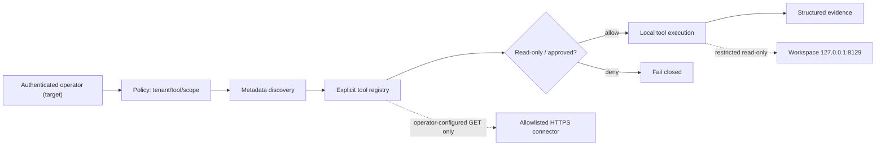

# SYNERGY META-API — научно-технический паспорт универсального API/MCP gateway

**Audit 2026-10-24 · Main: documentation stub · Implementation: [integration/meta-api-mcp-v0.1](https://github.com/Shtenco/synergy_meta_api/tree/integration/meta-api-mcp-v0.1) · Stage: experimental local prototype, not production.**

## Исследовательская задача

Нужен унифицированный контролируемый путь: *метаданные API → нормализованный каталог инструментов → проверка policy → локальное выполнение разрешённого tool/workflow → provenance*. Центральная проблема не в наличии тысяч каталогизированных APIs, а в **авторизованной доказуемой исполнимости** без незаметного повышения полномочий модели, SSRF, бесконтрольной мутации данных и утечки ключей.

Содержимое реального `main` на дату аудита: **только этот README**. Python runtime, тесты, манифест внешних проектов и спецификации присутствуют **только** в отдельной интеграционной ветке. Это принципиально при оценке готовности и для инвесторов, и для разработчиков.

## Матрица подтверждённых исходников

| Компонент | Код в ветке integration | Конкретная способность | Доказательная граница |
|---|---|---|---|
| FastAPI gateway | [app.py](https://github.com/Shtenco/synergy_meta_api/blob/integration/meta-api-mcp-v0.1/src/synergy_meta_api/app.py) | `/healthz`, `/v1/sources`, `/v1/tools`, `/mcp`, `/v1/tools/call` | Ограниченное MCP JSON-RPC, нет полного streaming/sessions/OAuth |
| Tool allowlist | `app.py:invoke()` | `synergy_health`, `synergy_list_sources` | Только локальные read-only функции |
| External HTTP adapter | [runtime.py](https://github.com/Shtenco/synergy_meta_api/blob/integration/meta-api-mcp-v0.1/src/synergy_meta_api/runtime.py) | Явно конфигурированные HTTPS host/path/method, ответ до 2 MB | DNS check не устраняет целиком DNS rebinding; только GET |
| Policy | [policy.py](https://github.com/Shtenco/synergy_meta_api/blob/integration/meta-api-mcp-v0.1/src/synergy_meta_api/policy.py) | Tenant/tool/scope/readonly filtering; DENY default | Dataclass policy не тождественна полноценной multi-tenant auth |
| Workflows | [workflow.py](https://github.com/Shtenco/synergy_meta_api/blob/integration/meta-api-mcp-v0.1/src/synergy_meta_api/workflow.py) | Ограниченная локальная последовательность шагов | Нет фоновых production task workers |
| Workspace bridge | [workspace_bridge_api.py](https://github.com/Shtenco/synergy_meta_api/blob/integration/meta-api-mcp-v0.1/src/synergy_meta_api/workspace_bridge_api.py) | Loopback `127.0.0.1:8129`, два отдельных bearer token | Лишь capabilities и read-only tasks/capital summary |
| Third-party inventory | [upstreams.json](https://github.com/Shtenco/synergy_meta_api/blob/integration/meta-api-mcp-v0.1/upstreams.json) | 18 upstream links | Регистрация не означает ownership или внедрение кода |
| Tests | [tests/](https://github.com/Shtenco/synergy_meta_api/tree/integration/meta-api-mcp-v0.1/tests) | FastAPI TestClient, MockTransport, reject/deny tests | Mock E2E не подтверждает реальную интеграцию провайдеров |

## Архитектура полномочий



**Авторизация инструмента — не следствие его присутствия в каталоге.** Аутентификация, разрешение и capability-bound consent должны проверяться сервером, а не выводиться из подсказки модели. В текущем коде некоторые локальные маршруты не имеют production-grade operator auth; поэтому gateway должен оставаться на localhost / в изолированной тестовой сети.

### Формальный контракт

Пусть `p=(tenant, tool, scopes, allow, read_only)`, а запрос `r=(tenant',tool',scopes_required,mutating)`.

$$
permit(r,p) = p.allow\land(tenant=tenant')\land(tool=tool')\land(scopes_{required}\subseteq scopes).
$$

Если `permit=false`, решение **DENY**. Если запрос мутирующий, политика возвращает **DENY** для `read_only` либо **APPROVAL_REQUIRED**, но **сама политика не является реализацией механизма утверждения**. До независимой проверки authorizer любые writes должны блокироваться.

### Trust boundaries

- Discovery metadata ≠ доступ к внешнему API.
- Список 18 upstream ≠ внедрение 18 продуктов и не право на перераспространение их кода.
- Пользователь не выбирает произвольный URL для коннектора; он выбирает имя и разрешённый путь.
- `verify_destination` проверяет HTTPS, стандартный порт 443, глобальные IP, запрет localhost/private CIDRs и redirects; нужны дополнительные egress/DNS anti-rebinding проверки.
- `SYNERGY_ENABLE_CONNECTOR_CALLS` должен оставаться disabled на публичных инсталляциях.
- META-API Workspace bridge не предоставляет unrestricted shell, почту, сообщения, платежи, торги или внешнюю публикацию.

## Воспроизведение: только интеграционная ветка

```bash
git clone https://github.com/Shtenco/synergy_meta_api.git
cd synergy_meta_api
git switch integration/meta-api-mcp-v0.1
python -m pip install -e '.[test]'
python -m pytest -q
uvicorn synergy_meta_api.app:app --host 127.0.0.1 --port 8000
```

После запуска:

```bash
curl -fsS http://127.0.0.1:8000/healthz
curl -fsS http://127.0.0.1:8000/v1/tools
```

Ожидаемая область: read-only локальный прототип. Не запускать публичный сервер, пока отсутствуют tenant isolation, secure identity, external policy enforcement, credentials vault и endpoint security audit.

## Проверка научных утверждений

| Гипотеза | Falsification test | Критерий |
|---|---|---|
| Система отказывает по умолчанию | Unknown tool / missing scope / tenant mismatch | Fail-closed |
| Нет внешнего произвольного POST | `POST` connector под любыми allowed paths | Отказ |
| Нет unrestricted SSRF | localhost, RFC1918, invalid scheme, redirects, DNS changes | Все запрещённые назначения отказаны; anti-rebinding отдельно |
| Bridge не превращается в execution bus | Любой capability кроме `tasks.list` и `capital.summary` | 403 |
| Модель не может назначить сама себя исполнителем | Text prompt с именем несуществующего tool | Unknown tool |
| Registry корректен | Exact provenance, refs, upstream SHA и license | Ещё требует independent audit |
| Production readiness | GitHub Actions green + repeatable tests + authenticated live integration | **Не установлена** |

[CI diagnosis](https://github.com/Shtenco/synergy_meta_api/blob/integration/meta-api-mcp-v0.1/docs/CI_DIAGNOSIS.md) фиксирует прошлые неуспешные workflow runs без доступного traceback: нельзя утверждать, что причина была в `pytest`.

## Необходимые следующии рубежи

1. Принять integration branch в `main` только после code/security review и CI.
2. Выделить authn/authz и approval-state machine; для mutating tools — approval + idempotency + audit.
3. Изолировать DNS lookup от фактического connect, зафиксировать разрешённые IP/host, запретить redirect/credential leaks.
4. Добавить версии схем OpenAPI и MCP, content hashes, timeout/circuit breaker/quotas.
5. Провести реальные, но авторизованные, multi-tenant и workload-evidence испытания.

**Статус:** научная документация этого проекта глубокая, но реализованная интеграционная ветка не является готовым production gateway.

---

## Историческая версия README

# synergy_meta_api
